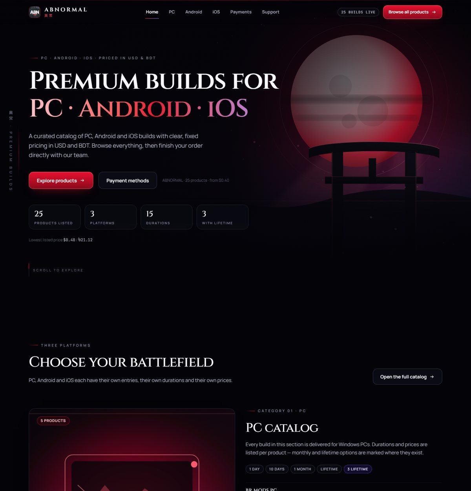
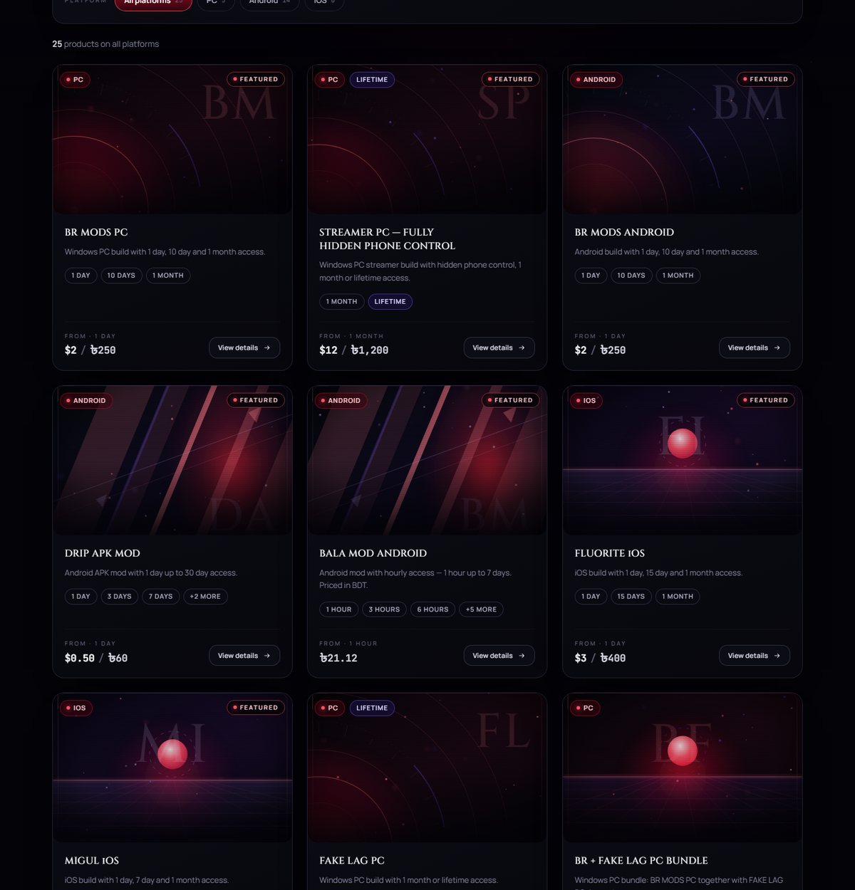
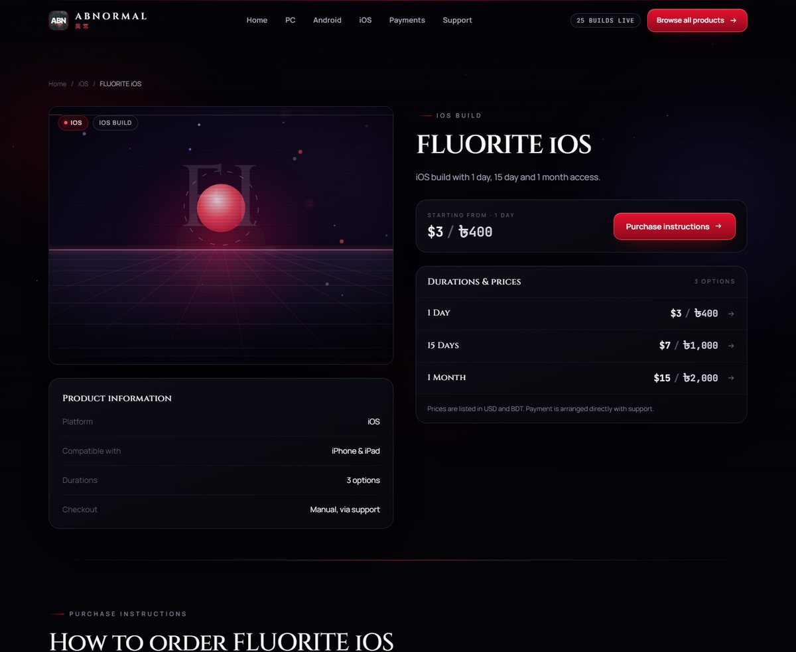
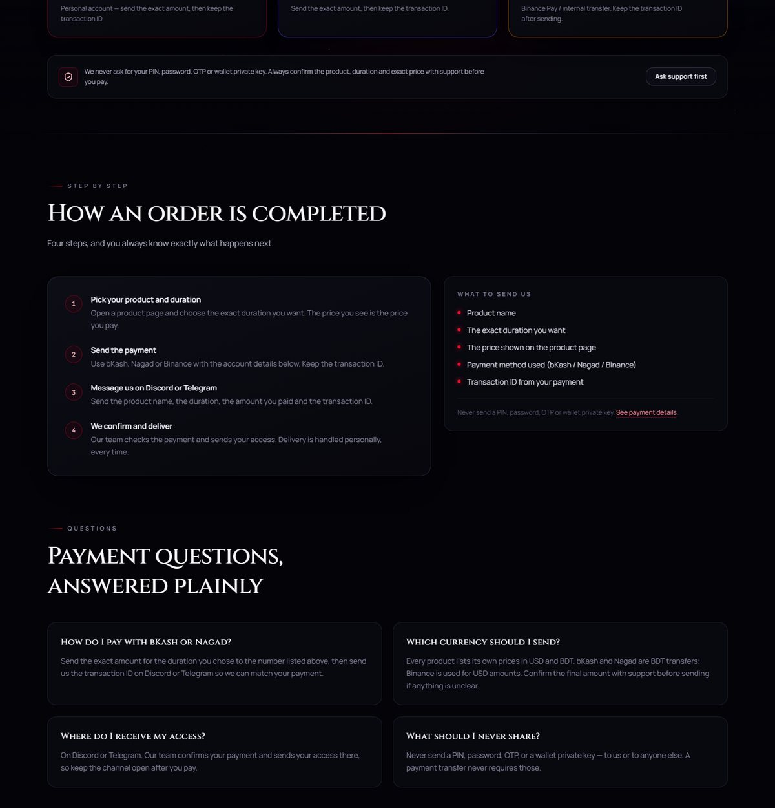

# ABNORMAL — Premium Anime-Themed Product Store

A **public, no-login product catalog** for PC, Android and iOS builds.
Built with **Next.js + TypeScript + Tailwind CSS**. No database, no admin panel, no accounts, no checkout — just a fast, cinematic storefront you can share as a single URL.



---

## 1. What this is (and what it is not)

**It is**

- A fully public catalog: anyone with the link can browse every product, duration and price.
- Searchable and filterable by platform (PC / Android / iOS), by duration, and sortable by price.
- Data-driven: all products live in **one** file you can edit in a text editor.
- Ready to deploy to Vercel in a few minutes (see [DEPLOYMENT.md](DEPLOYMENT.md)).

**It is not**

- ❌ No admin panel, no administrator login
- ❌ No customer login or registration
- ❌ No dashboard
- ❌ No database
- ❌ No payment gateway, no automatic payment verification
- ❌ No fake cart / fake checkout screens

Ordering happens **manually** through Discord or Telegram: the visitor picks a duration, pays with bKash / Nagad / Binance, then confirms with support. The site says exactly that — nothing pretends to be automatic.

---

## 2. Run it locally (5 minutes)

**Requirements:** [Node.js](https://nodejs.org) **20.9 or newer** (LTS is fine).

```bash
# 1. install dependencies
npm install

# 2. start the dev server
npm run dev

# 3. open the site
#    → http://localhost:3000
```

Other useful commands:

| Command | What it does |
| --- | --- |
| `npm run dev` | Development server with hot reload (also warns you in the terminal if the catalog has a mistake) |
| `npm run build` | Production build — run this before deploying to catch any error |
| `npm run build:static` | Exports the whole site as plain HTML into `out/` — this is what **Cloudflare Pages** and other static hosts use |
| `npm start` | Serves the production build locally (run `npm run build` first) |
| `npm run typecheck` | Checks all TypeScript types without building |

> Using pnpm or yarn instead? `pnpm install && pnpm dev` works exactly the same.

---

## 3. Make it yours — 3 things to change first

Open **`src/data/store.ts`**. Everything in this file is public information (it ships to the browser), so never put passwords or API keys in it.

| What | Constant | Notes |
| --- | --- | --- |
| Store name | `STORE_NAME` | Shown in the logo, page titles and footer |
| Japanese subtitle | `STORE_NAME_KANJI` | Decorative only — change or keep |
| Tagline / description | `STORE_TAGLINE`, `STORE_DESCRIPTION` | Used in the hero and in SEO metadata |
| Your public URL | `STORE_URL` | Replace after deploying, e.g. `https://my-store.vercel.app` (used for the sitemap and social preview) |
| **Discord link** | `DISCORD_URL` | Replace `YOUR_DISCORD_INVITE_URL` with e.g. `https://discord.gg/abc123` |
| **Telegram link** | `TELEGRAM_URL` | Replace `YOUR_TELEGRAM_SUPPORT_URL` with e.g. `https://t.me/yourname` |
| Payment accounts | `PAYMENT_METHODS` | bKash / Nagad / Binance details + the copy buttons |
| Safety notice | `PAYMENT_SAFETY_NOTE` | The "never share a PIN/OTP" line |
| Order steps | `ORDER_STEPS` | The four steps shown on the home, payments and product pages |

**Why the support buttons are disabled right now:** while `DISCORD_URL` and `TELEGRAM_URL` still contain the placeholder text, the buttons stay greyed out and show a short "not configured yet" hint. That is deliberate — a visitor is never sent to a broken link. Paste your real URLs and the buttons become live immediately.

---

## 4. Editing the catalog — `src/data/products.ts`

This is the **only** file you touch to add, change or remove a product. It is plain readable TypeScript, and each product is one block between `{` and `}`.

### Add a new product (copy this)

```ts
{
  slug: 'my-new-product',              // unique, lowercase-with-dashes → /products/my-new-product
  name: 'MY NEW PRODUCT',              // shown exactly as written
  platform: 'android',                 // 'pc' | 'android' | 'ios'
  summary: 'One short line for the product card.',
  compatibility: 'Android',            // optional
  details: ['Hourly plans available'], // optional factual bullets
  prices: [
    { duration: '1 Day', usd: 2, bdt: 250 },
    { duration: '7 Days', usd: 5, bdt: 600 },
    { duration: 'Lifetime', usd: 20, bdt: 2400 },
  ],
  featured: true,                      // optional: shows on the homepage shelf
  tags: ['APK'],                       // optional small chips
  // image: '/art/my-new-product.jpg', // optional: use real artwork (see §6)
}
```

Paste it into the right list (`PC_PRODUCTS`, `ANDROID_PRODUCTS` or `IOS_PRODUCTS`), save, and refresh — the product appears in the catalog, the search index, the platform page, the sitemap and its own detail page automatically.

### Rules that keep the store accurate

- **Prices you don't know, leave out.** A price entry may have `usd` only, `bdt` only, or both — the store prints exactly what you configure and never invents a conversion.
- **Same product on two platforms = two entries** (for example `br-mods-pc` and `br-mods-android`). Each platform has its own page, prices and durations.
- **Every product has its own durations.** Nothing is shared or assumed: one product can be hourly, another daily, another lifetime.
- If you leave a price value out entirely, the terminal prints a warning while `npm run dev` is running, so mistakes are easy to spot.

### Duration labels you can use

Any label works, because the label is simply printed as written and sorted by its meaning:

| Access type | Example label | Example price line |
| --- | --- | --- |
| Hourly | `'1 Hour'`, `'6 Hours'`, `'12 Hours'` | `{ duration: '6 Hours', bdt: 126.72 }` |
| Daily | `'1 Day'`, `'2 Days'`, `'3 Days'` | `{ duration: '3 Days', usd: 3, bdt: 400 }` |
| Weekly | `'7 Days'`, `'10 Days'`, `'15 Days'` | `{ duration: '15 Days', usd: 4.5, bdt: 530 }` |
| Monthly | `'28 Days'`, `'30 Days'`, `'1 Month'` | `{ duration: '1 Month', usd: 5, bdt: 600 }` |
| Long / lifetime | `'1 Year'`, `'Lifetime'` | `{ duration: 'Lifetime', usd: 20, bdt: 2000 }` |

Custom durations (like `'28 Days'` or `'10 Days'`) are supported as-is — just write the label you want customers to see.

### Current catalog

**PC (5)** BR MODS PC · FAKE LAG PC · BR + FAKE LAG PC BUNDLE · ABNORMAL AIMBOT PREMIUM PC · STREAMER PC — FULLY HIDDEN PHONE CONTROL
**Android (14)** BR MODS ANDROID · DRIP APK MOD · DRIP PROXY · PRIME APK MOD · DRIP R00T ANDROID · AIM HACK — NON ROOT ANDROID · DRIP WIRE — NON ROOT ANDROID · PATO BLUE APK MOD · PATO ORANGE APK MOD · PATO GREEN APK MOD · PATO YELLOW · SILENTCEATS APK MOD · BALA MOD ANDROID · ROCKET MOD
**iOS (6)** FLUORITE iOS · MIGUL iOS · GBOX & ESIGN · iOS EXTERNAL · AIM HACK — NON ROOT iOS · DRIP WIRE — NON ROOT iOS

Counts, prices, duration chips and the "lowest price" figures shown on the site are all calculated from this data — nothing is hard-coded.

---

## 5. Pages

| Route | What's there |
| --- | --- |
| `/` | Cinematic hero, three platform category sections, featured shelf, full catalog with search/filters, payments, support |
| `/pc` · `/android` · `/ios` | One platform per page: intro, duration overview, that platform's products with search & sort, payments and support |
| `/products` | The complete catalog with search, platform + duration filters and price sorting |
| `/products/[slug]` | Product detail: artwork, all durations with exact prices, purchase instructions, payment cards, support buttons, related products |
| `/payments` | bKash / Nagad / Binance cards with copy buttons, the four order steps, FAQ |
| `/support` | Discord + Telegram buttons, what to send us, what we never ask for, payment recap |
| `/sitemap.xml`, `/robots.txt`, `/opengraph-image` | Generated automatically for search engines and social previews |




---

## 6. Artwork

Every product ships with **original, generated SVG artwork** (layered gradients, horizons, rings, grids and orbital marks built from the product's own name). Nothing is downloaded, nothing is copyrighted, and the whole catalog adds almost no image weight.

Want real images instead? Drop a file into `public/art/` and point the product at it:

```ts
image: '/art/br-mods-pc.jpg',
imageAlt: 'BR MODS PC key art',
```

`next/image` then takes over: responsive sizes, lazy loading, and AVIF/WebP optimisation on Vercel. If a file is missing you will get a build-time error listing the exact path, so typos are easy to fix. Remove the `image` line to go back to generated art.



---

## 7. Project structure

```
abnormal-store/
├─ src/
│  ├─ app/                     # pages (Next.js App Router)
│  │  ├─ layout.tsx            # fonts, header, footer, background atmosphere
│  │  ├─ page.tsx              # homepage
│  │  ├─ pc/ android/ ios/     # platform pages
│  │  ├─ products/             # full catalog + [slug] product pages
│  │  ├─ payments/ support/    # payment guide + support centre
│  │  ├─ globals.css           # design tokens (colours, motion) + components
│  │  ├─ icon.svg              # favicon
│  │  ├─ opengraph-image.tsx   # social preview card
│  │  ├─ sitemap.ts robots.ts  # SEO files
│  │  └─ not-found.tsx         # 404 page
│  ├─ components/              # reusable UI, separate from the data
│  │  ├─ hero.tsx  artwork.tsx  product-card.tsx  catalog-explorer.tsx
│  │  ├─ price-list.tsx  payment-cards.tsx  support-panel.tsx
│  │  ├─ site-header.tsx  site-footer.tsx  ui.tsx  copy-button.tsx  reveal.tsx
│  ├─ data/
│  │  ├─ products.ts           # ← THE CATALOG (products, prices, platforms)
│  │  └─ store.ts              # ← STORE SETTINGS (name, links, payments)
│  └─ lib/                     # catalog queries, price formatting, link checks
├─ public/art/                 # optional real product images
├─ docs/                       # preview images used by this README
├─ DEPLOYMENT.md               # beginner deployment guide (Vercel + GitHub)
└─ package.json
```

Data and design are fully separated: `src/data/*` holds facts, `src/components/*` holds presentation. You can re-theme the whole store from `globals.css` without touching a single product.

---

## 8. Good to know

- **Collections, not a database.** The catalog is compiled into static HTML at build time, so pages load instantly and cannot be "hacked" through a query — there is no server-side state at all.
- **Price sorting with two currencies.** Some products are priced in USD, others only in BDT. To sort a mixed list, `SORT_BDT_PER_USD` in `src/data/store.ts` is used **only for ordering** — it is never displayed and never changes a price you configured. Adjust it if you want a different ordering.
- **No secrets.** There are no API keys and no environment variables to configure. Everything the site needs is public data in `src/data/`.
- **Accessibility.** A skip link, labelled controls, keyboard-focus rings, `aria-pressed` filter buttons, live regions for search results and copy feedback, plus a `prefers-reduced-motion` mode that disables all animations.
- **No external requests at runtime** other than the self-hosted Google fonts downloaded at build time.

---

## 9. Troubleshooting

| Problem | Fix |
| --- | --- |
| `npm install` fails | Check you are on Node 20.9+ (`node -v`). Delete `node_modules` and `package-lock.json`, then retry. |
| Port 3000 already in use | `npm run dev -- -p 3001` |
| A product does not appear | Check for a duplicate `slug` — the dev terminal prints a warning for duplicates and empty prices. |
| Support buttons look disabled | `DISCORD_URL` / `TELEGRAM_URL` still contain the placeholder text. Paste your real links in `src/data/store.ts`. |
| Prices look wrong in a screenshot | They come straight from `src/data/products.ts`; the site never converts or rounds them. |
| Build fails about a missing image | The `image` path does not exist in `public/art/`. Fix the path or remove the line. |

---

## 10. Deploy

The project runs on **Vercel** with no configuration at all, and on **Cloudflare Pages** through the static export (`npm run build:static` → `out/`). Both are covered step by step for someone with **nothing installed** — no Node, no Git, no terminal:

**[DEPLOYMENT.md](DEPLOYMENT.md)**

Short version:

1. Upload this folder to a GitHub repository (drag & drop in the browser works).
2. **Vercel:** Add New → Project → Import the repo → Deploy. Nothing else to configure.
   **Cloudflare Pages:** Connect to Git → framework preset *Next.js (Static HTML Export)* → build command `npm run build:static` → output directory `out`.
3. Open the URL you are given and share it. Updates happen automatically after every commit.

> The social preview image lives at `public/og.png` (1200×630). Replace that file if you ever want a different link preview — it is a plain image, so it works on every host.

---

Built as an original design. No third-party branding, source code, artwork or layout is copied — all graphics are generated from the store's own data and colours.
